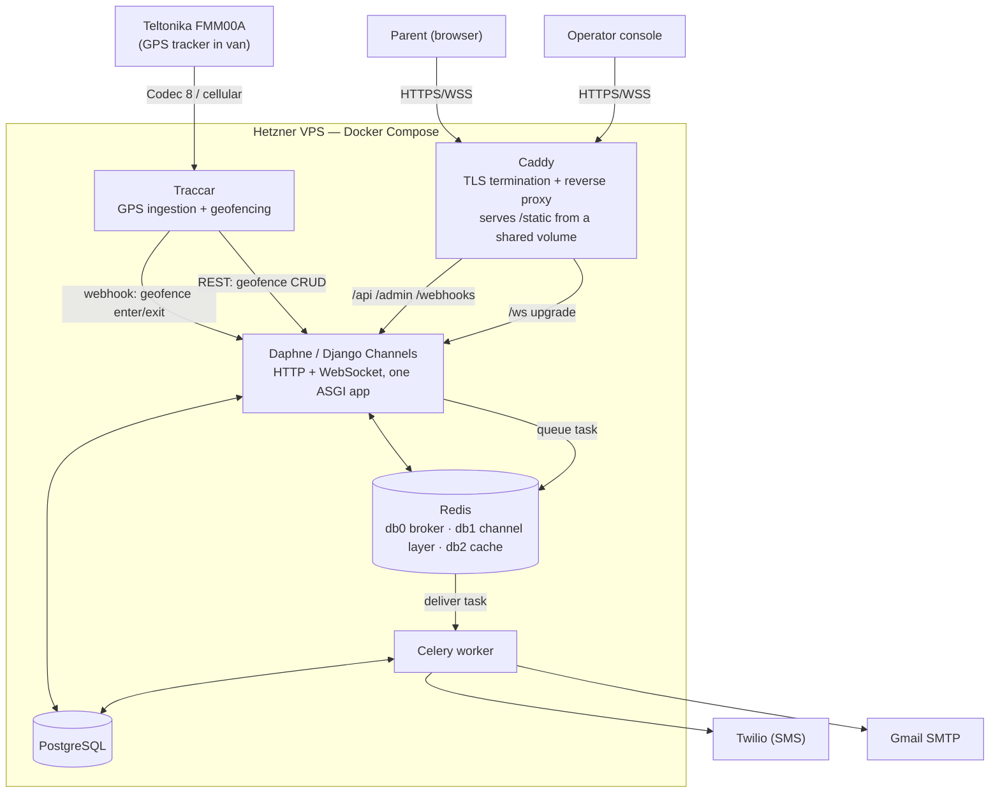

# Gina Gymnastics Tracker

Real-time van tracking for a gymnastics center's school pickup service. A GPS tracker on the van reports through Traccar, and a Django backend turns raw position data into two useful things: an arrival notification to the right parents, and a live map scoped to their child's ride.

This repo is the backend, Traccar, and Caddy. The React frontend (parent app and operator console) lives in [gina-ride-tracker-web](https://github.com/elperroloc0/gina-ride-tracker-web).

Setting this up from scratch (device, SIM, Traccar, backend, frontend)? See [SETUP.md](SETUP.md).

## Demo

...

| Parent: live ride | Operator console | Arrival text |
|---|---|---|
|  |  |  |

**Live app:** _link goes here._

## Why these choices

**Daphne + Django Channels instead of plain WSGI.** The frontend needs a live van marker, which means the server has to hold a WebSocket open for each connected client while also serving normal HTTP. WSGI can't do both, so the whole backend runs as a single ASGI application (`backend/asgi.py`) under Daphne: the same process serves the REST API and upgrades `/ws/` connections.

**A ticket-based WebSocket auth handshake, not cookies.** The frontend is a separate origin (deployed on Vercel) talking to this API cross-origin, and browsers don't attach `Authorization` headers to WebSocket upgrade requests. `tracking/middleware.py` solves this without inventing a second auth system: the client requests a short-lived ticket over normal authenticated HTTP, then opens the socket with `?ticket=...`; the middleware resolves it to a user via a one-time Redis cache lookup (`cache.delete` on read) and discards it. `channels.security.websocket.AllowedHostsOriginValidator` then checks the `Origin` header against the same `ALLOWED_HOSTS`/CORS list the rest of the app trusts.

**Per-ride Channels groups instead of one broadcast.** A parent's socket only joins `van_position_{van_id}` for their own child's active ride (`tracking/consumers.py`), resolved server-side from the JWT-authenticated user — never a client-supplied van ID. A parent can't listen to another family's van by guessing an ID, and when a ride ends the server closes their socket rather than trusting the client to disconnect.

**Traccar owns GPS ingestion; Django owns none of it.** Traccar decodes the tracker's wire protocol, stores position history, and evaluates geofence enter/exit — solved problems that don't need reinventing. Django only receives Traccar's webhook, and everything downstream (which children are on that route in that time window, who to notify, what the live map shows) is business logic Traccar has no model for.

**Celery + Redis instead of sending notifications inline.** The Traccar webhook has to return fast — Traccar doesn't wait around for an SMS provider. `notifications/tasks.py` queues delivery (`delay_on_commit`, so nothing fires if the surrounding transaction rolls back) and a separate worker process handles the actual Twilio/SMTP call, retries, and backoff. One Redis instance backs three roles, split by logical DB number specifically so they can't collide: `/0` Celery broker, `/1` Channels layer, `/2` cache (`backend/settings.py`).

**Schedule-based notification targeting, not a daily roster.** A `Child` is tied to a route, day-of-week, and time window, not a day-by-day attendance record — at the scale this is built for, confirming a roster every single day doesn't hold up. An arrival event fans out to whichever children's schedules match that route and window; an occasional notification for a child who wasn't on the van that day is an accepted tradeoff against a system that requires daily manual upkeep.

**Caddy as the sole public entrypoint.** One reverse proxy terminates TLS (automatic cert issuance/renewal), serves collected static files directly from a shared volume, and forwards everything else — including the `/ws/` upgrade, transparently, with no special-casing — to Daphne. Traccar's own web UI is bound to `127.0.0.1` only and reached over an SSH tunnel; it's an admin tool for provisioning geofences, not something to expose publicly.

## Architecture



Request flow for the two events that matter: the van enters or leaves a geofence → Traccar posts a webhook to Django → Django resolves the matching children by route/schedule, writes an `ArrivalEvent`, publishes the new position to that van's Channels group (parents watching that ride see the map update immediately), and queues a Celery task that sends SMS or email to the matched parents' preferred channel.

## Production configuration

- **Non-root container user.** [`backend/Dockerfile`](backend/Dockerfile) creates `appuser` and switches to it before the entrypoint runs — the Daphne process never runs as root.
- **Multi-stage build.** Dependencies are installed into a virtualenv in a `builder` stage; the runtime image copies only that venv and the app code, not the `pip install` layer or build context around it. Today's dependencies don't need a C compiler, but the split means one that does (a future package without a prebuilt wheel) only grows the discarded builder stage, never the shipped image.
- **Environment isolation.** No secret ever lives in the image or in git — `.env` is git-ignored and Docker-ignored, and `compose.yaml` injects it per-service via `env_file`. `backend/settings.py` fails fast (`ImproperlyConfigured`) if `DJANGO_SECRET_KEY`, `ALLOWED_HOSTS`, or `CORS_ALLOWED_ORIGINS` are missing with `DEBUG=False`, rather than silently booting insecure.
- **HTTPS enforced end-to-end.** Caddy issues and renews TLS automatically; Django trusts `X-Forwarded-Proto` from Caddy and forces `SECURE_SSL_REDIRECT`, secure cookies, and HSTS once `DEBUG=False` — with a narrow, documented exemption for the health check and Traccar webhook, which reach Django over the internal compose network without ever passing through Caddy.
- **Traccar's admin UI is not public.** It's bound to `127.0.0.1` inside its container and reached only via SSH tunnel — it has no TLS and a password-only login, so it's deliberately never proxied through Caddy.

## Stack

| Layer | Choice |
|---|---|
| Backend | Django 6, Django REST Framework, Django Channels |
| Realtime transport | Daphne (ASGI), Channels Redis layer |
| Async work | Celery, Redis broker |
| Database | PostgreSQL |
| GPS ingestion | Traccar (self-hosted) |
| Reverse proxy / TLS | Caddy |
| Notification delivery | Twilio (SMS), Gmail SMTP (email) |
| Deployment | Docker Compose on a Hetzner VPS |
| Frontend | React (separate repo, deployed on Vercel) |

## Tests

134 backend tests cover the WebSocket ticket handshake, cross-parent data isolation, the Traccar webhook and geofence provisioning, schedule-based notification targeting, and the invite and password flows.

```bash
docker compose exec django python manage.py test
```
